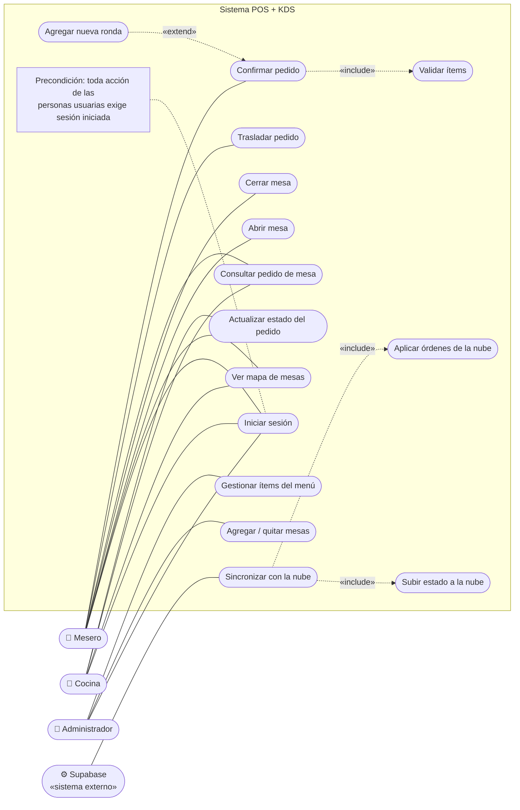

# 1. Diagrama de casos de uso

## Nota de lectura
- La frontera encierra lo que el servidor local y la SPA hacen hoy: mesas, pedidos, menú, sesión y réplica en la nube. Quedan fuera pagos, ventas e inventario porque no existen en el código.
- `Iniciar sesión` es **precondición** y no un «include»: dibujar un «include» desde cada caso de uso suma una flecha por caso sin decir nada nuevo, porque la regla es una sola (`exigirToken` y `exigirTokenSocket`, un mismo `UsuarioService.verificarToken`).
- `Confirmar pedido` **incluye** `Validar ítems` porque `PedidoService._validarItems` corre siempre (cantidad 1–99, ítem existente y disponible). `Agregar nueva ronda` **extiende** `Confirmar pedido` solo si la mesa ya está `En Cocina 🍳`; el caso base no la necesita.
- `Sincronizar con la nube` **incluye** `Subir estado a la nube` (`subirEstado`) y `Aplicar órdenes de la nube` (`procesarOrdenes`): `Sincronizador.ciclo()` ejecuta siempre ambos. Supabase es actor externo porque es quien deja las órdenes en el buzón `ordenes_pendientes`. Netlify no es actor: solo entrega archivos estáticos y no inicia ninguna acción (aparece en el diagrama de componentes).
- Los roles Mesero, Cocina y Administrador son uso previsto: no hay roles en el código y cualquier usuario con sesión puede hacer todo. Se dibujan para mostrar quién usa cada caso, no para decir quién puede.
- `Gestionar ítems del menú` existe como API REST (`/api/menu-items`); la SPA hoy solo consume la lista, así que ese caso se hace desde un cliente HTTP.
