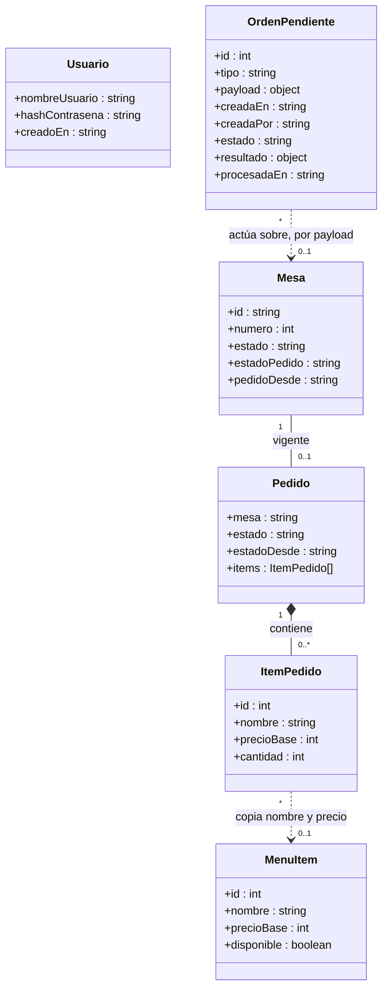

# 2. Diagrama de clases (dominio)

## Nota de lectura
- Son objetos JavaScript sin modificadores de acceso: todo se marca `+` (público). Los valores posibles están en el dominio: `Mesa.estado` es `libre` u `ocupada`; `Pedido.estado` y `Mesa.estadoPedido` son `Recibido 📝`, `En Cocina 🍳` o `Listo 🍽️` (`ESTADOS_VALIDOS` en `pedido.service.js`); `OrdenPendiente.estado` es `pendiente`, `aplicada` o `rechazada`.
- `Pedido` no tiene id propio: su clave es la mesa (`pedidos.mesa_id` PRIMARY KEY), por eso Mesa–Pedido es 1 a 0..1. `estadoPedido` y `pedidoDesde` no son columnas de `mesas`: las agrega `MesasConEstadoPedido` al leer.
- Composición Pedido–ItemPedido: `pedido_items` referencia `pedidos` con `ON DELETE CASCADE` y no existe sin su pedido. El lado de los ítems es `0..*` y no `1..*` porque `actualizarEstado` crea el pedido en `Recibido 📝` antes de que tenga ítems.
- `ItemPedido` copia nombre y precio del menú al confirmar, sin clave foránea a `menu_items`: editar el menú no altera pedidos ya tomados. Por eso es dependencia y no asociación.
- `Usuario` queda sin relaciones a propósito: el pedido no guarda quién lo tomó, y los usuarios viven en dos almacenes distintos (tabla `usuarios` de SQLite en local, Supabase Auth en la nube). `OrdenPendiente.creadaPor` es el id del usuario de Supabase Auth, no un `Usuario` local.
- `OrdenPendiente` es la tabla `ordenes_pendientes` de Supabase (`supabase/esquema.sql`); no hay una clase con ese nombre en el código. Apunta a una mesa solo dentro de su `payload` (jsonb), sin clave foránea, y el servidor local la aplica llamando a los servicios de dominio. Los servicios se muestran en el diagrama de componentes.
