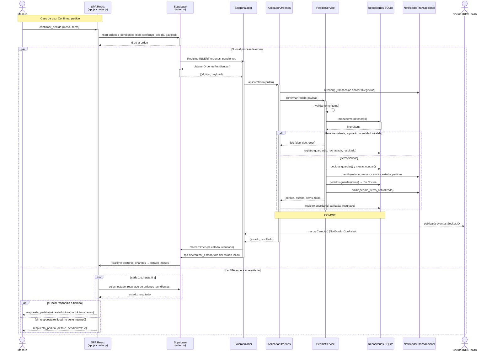

# 3. Diagrama de secuencia — Confirmar pedido

Caso de uso modelado: **Confirmar pedido**, iniciado desde la web pública (modo nube). Es el recorrido más largo del sistema: toca la SPA, Supabase, el servidor local y vuelve.

## Nota de lectura
- Se eligió este caso porque une los dos mundos del sistema híbrido: la web no escribe datos, deja una orden, y el servidor local sigue siendo la autoridad. En modo local el recorrido es el mismo desde `PedidoService.confirmarPedido` hacia abajo; solo cambia la puerta de entrada (`socket.handlers` en vez de `AplicadorOrdenes`).
- Las reglas se validan una sola vez, en `PedidoService`, nunca en la SPA ni en Supabase: por eso el `alt` cubre el rechazo (ítem agotado o cantidad fuera de 1–99) y la orden queda `rechazada` con su motivo en vez de perderse.
- Los eventos se **retienen hasta el COMMIT** (`NotificadorTransaccional`): si algo falla, la cocina no recibe el aviso de un pedido que no existe. `AplicadorOrdenes` anota la orden en la misma transacción para que, si se corta internet antes de `marcarOrden`, al reintentar no se aplique dos veces.
- La SPA espera como máximo 8 s el resultado. Si el local no responde, devuelve `pendiente:true` y no un error, para que nadie reenvíe la orden y quede duplicada. Por eso el segundo `alt`.
- La subida a Supabase ocurre después del COMMIT y de forma asíncrona (`marcarCambio` espera 300 ms): el POS local nunca espera a la nube.
- `confirmarPedido` llama internamente a `actualizarEstado` dos veces (Recibido → En Cocina) y emite `estado_mesas` solo al ocupar la mesa; el diagrama lo resume. Mensajes verificados en `ordenes-nube.js`, `sincronizador.js`, `pedido.service.js`, `transacciones.js` y `nube.js`.
