# 4. Diagrama de componentes

Notación: `((círculo))` = interfaz con nombre; línea continua = el componente la **provee** (bola); flecha punteada = el componente la **requiere** (enchufe). Borde discontinuo = componente **externo**.

```mermaid
flowchart LR
  USR(["👤 Mesero · Cocina · Administrador<br/>«actor externo»"])
  UI(("Pantallas<br/>POS + KDS"))
  SPA["«component»<br/>SPA React (SCD_TP_F)<br/>componentes/ · servicios/api.js · servicios/nube.js"]
  WEB(("Sitio web<br/>HTTPS estático"))
  NETLIFY["«external»<br/>Netlify<br/>hosting del build (dist)"]

  REST(("API REST<br/>/api/auth/login · /api/mesas<br/>/api/menu-items (Bearer JWT)"))
  WS(("Eventos<br/>Socket.IO"))

  subgraph SRV["Servidor local Node.js (SCD_TP_B) — el PC de la comanda"]
    PRE["«component»<br/>Presentación<br/>auth.router, mesas.router, menu-items.router,<br/>socket.handlers, autenticacion, AplicadorOrdenes"]
    SVC(("Servicios<br/>de dominio"))
    DOM["«component»<br/>Dominio<br/>PedidoService, MesaService, MesaEstadoService,<br/>MesaConfiguracionService, MenuItemService, UsuarioService"]
    REP(("Repositorio"))
    NOT(("Notificador<br/>.emitir"))
    SEGI(("Seguridad<br/>hashear · verificar · firmar"))
    subgraph INF["infraestructura/"]
      SQL["«component»<br/>sqlite/<br/>repositorios SQLite, transacciones"]
      NOTI["«component»<br/>notificador<br/>SocketNotificador, NotificadorTransaccional"]
      SEG["«component»<br/>seguridad/<br/>contrasenas (scrypt), tokens (JWT)"]
      SYN["«component»<br/>sincronizacion/<br/>Sincronizador, estado-local, registro-ordenes"]
      CLI["«component»<br/>sincronizacion/cliente-supabase"]
    end
    ORD(("aplicarOrden"))
    NUBE(("Cliente de nube<br/>subirEstado · obtenerOrdenesPendientes<br/>marcarOrden · suscribirOrdenes"))
  end
  DB[("SQLite (archivo .db)<br/>persistencia local")]

  SBAPI(("API de Supabase<br/>Data API (PostgREST + rpc) · Realtime · Auth"))
  subgraph SUP["Supabase (proyecto scd-tp-pos-kds)"]
    SB["«external»<br/>Supabase"]
    PG[("Postgres (nube)<br/>mesas, menu_items, pedidos, pedido_items,<br/>ordenes_pendientes, sincronizar_estado()")]
  end

  USR -.-> UI
  SPA --- UI
  NETLIFY --- WEB
  SPA -.-> WEB
  PRE --- REST
  PRE --- WS
  SPA -. "modo local" .-> REST
  SPA -. "modo local" .-> WS
  DOM --- SVC
  PRE -.-> SVC
  SQL --- REP
  NOTI --- NOT
  SEG --- SEGI
  DOM -.-> REP
  DOM -.-> NOT
  DOM -.-> SEGI
  PRE --- ORD
  SYN -.-> ORD
  CLI --- NUBE
  SYN -.-> NUBE
  SQL -- "SQL (better-sqlite3)" --> DB
  SYN -- "SQL (lee el estado)" --> DB
  SB --- SBAPI
  SB --> PG
  CLI -. "llave secreta" .-> SBAPI
  SPA -. "modo nube<br/>llave publishable + sesión" .-> SBAPI

  classDef externo stroke-dasharray: 6 4,stroke-width:2px
  class NETLIFY,SB externo
```

## Nota de lectura
- Hay dos externos con roles distintos: **Netlify** solo entrega los archivos de la SPA (no guarda datos ni corre lógica) y **Supabase** es la réplica y el buzón. Por eso el producto no depende de ninguno: sin internet, la SPA local habla con el servidor del restaurante y nada más.
- La SPA tiene un único punto de acceso (`api.js`) y elige proveedor con `VITE_MODO`: REST + Socket.IO en modo local; la API de Supabase (Data API, Realtime y Auth) en modo nube (`nube.js`). Los componentes de pantalla no saben cuál se usa.
- El dominio no conoce SQLite, Socket.IO, scrypt, JWT ni Supabase: recibe repositorio, notificador y funciones de seguridad por constructor (`crearApp` en `app.js`). Por eso `repositorios.contrato.test.js` corre las mismas pruebas con repositorios en memoria y con SQLite.
- `Sincronizador` no conoce Supabase: usa la interfaz `Cliente de nube` y solo `cliente-supabase` importa `@supabase/supabase-js`. Sin `SUPABASE_URL` ni `SUPABASE_SECRET_KEY` no se crea ni se carga, y el sistema queda 100 % local.
- `AplicadorOrdenes` vive en Presentación porque es una tercera puerta de entrada al dominio, igual que REST y Socket.IO: traduce una orden de la nube a una llamada a `Servicios de dominio`, así las reglas existen en un solo lugar.
- La persistencia está dos veces con roles distintos: SQLite es la autoridad; Postgres de Supabase es una copia que se puede reconstruir subiendo el estado completo. Las interfaces JavaScript son contratos por convención de métodos, no declaradas formalmente.
