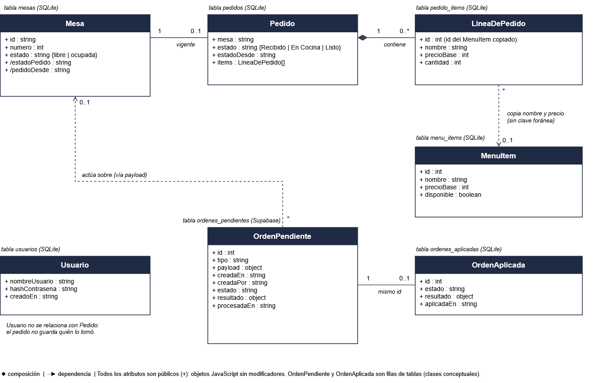

# Modelado del sistema (Entrega 3)

Cuatro diagramas UML del sistema POS + KDS tal como está construido en la rama final: servidor local (repo `SCD_TP_B`) y SPA (repo `SCD_TP_F`), con la réplica en Supabase, el inicio de sesión y el despliegue de la SPA en Netlify. Cada diagrama se versiona con su fuente editable (`.drawio`) y una imagen exportada. Las notas de lectura de cada uno están en este archivo.

| # | Diagrama | Qué responde | Imagen | Fuente editable |
| :--- | :--- | :--- | :--- | :--- |
| 1 | **Casos de uso** | Quién usa el sistema (incluido Supabase) y qué puede hacer | [`1-casos-de-uso.jpeg`](./1-casos-de-uso.jpeg) | [`1-casos-de-uso.drawio`](./1-casos-de-uso.drawio) |
| 2 | **Clases** | Qué conceptos del dominio existen y cómo se relacionan | [`2-clases.png`](./2-clases.png) | [`2-clases.drawio`](./2-clases.drawio) |
| 3 | **Secuencia** | Cómo se resuelve *Confirmar pedido*, mensaje por mensaje | [`3-secuencia.svg`](./3-secuencia.svg) | [`3-secuencia.drawio`](./3-secuencia.drawio) |
| 4 | **Componentes** | En qué piezas se divide el sistema y qué interfaces las conectan | [`4-componentes.jpeg`](./4-componentes.jpeg) | [`4-componentes.drawio`](./4-componentes.drawio) |

## Nota de lectura general

Los cuatro son un solo modelo y se pueden recorrer siguiendo un mismo concepto, **el pedido**: 
* En **casos de uso** es *Confirmar pedido* (con *Validar ítems* incluido y *Agregar nueva ronda* como extensión).
* En **clases** es `Pedido`, compuesto de `LineaDePedido` y colgado de una `Mesa`.
* En **secuencia** es el recorrido de *Confirmar pedido* por `PedidoService`.
* En **componentes** vive en *Dominio* y se guarda en *SQLite*. 

Los actores de casos de uso aparecen como líneas de vida (Mesero, Cocina, Supabase) o como componentes externos (Supabase, y los tres roles agrupados como actor externo).

## Notas de lectura por diagrama
 
### 1. Casos de uso
[INSERTAR NOTA DE LECTURA]

### 2. Clases
 

El diagrama muestra solo lo que el sistema guarda hoy, para poder compararlo con el código. Por eso no aparecen Venta, Categoria ni Receta, que estaban en el diseño original. Un Pedido está compuesto por sus LineaDePedido: una línea no tiene sentido sin su pedido, no se comparte con otros y se borra junto con él. Una Mesa tiene como máximo un Pedido en curso, porque el sistema no guarda historial. Cada LineaDePedido guarda una copia del nombre y del precio del producto, no un enlace al menú, así los pedidos ya tomados no cambian si después se sube un precio. Por eso la relación con MenuItem es una dependencia. estadoPedido y pedidoDesde no se guardan en la mesa: se calculan al leerla a partir de su pedido (por eso llevan /), así hay un solo lugar donde cambian y no pueden quedar desfasados. OrdenPendiente vive en Supabase y OrdenAplicada en SQLite, y comparten id para no aplicar dos veces una orden si se corta internet a mitad del proceso. OrdenPendiente depende de Mesa porque cada orden trae una mesa en su contenido; la multiplicidad es 0..1 porque agregar una mesa puede pedirse sin número. Usuario no se relaciona con Pedido porque el pedido no guarda quién lo tomó.
 
### 3. Secuencia
[INSERTAR NOTA DE LECTURA]
 
### 4. Componentes
[INSERTAR NOTA DE LECTURA]

## Decisiones que atraviesan los cuatro diagramas

* **El servidor local es la autoridad:** las reglas se ejecutan solo en Dominio.Supabase es una copia y un buzón de órdenes, no un segundo sistema con reglas propias.
* **El sistema funciona sin internet:** Supabase y Netlify son externos y opcionales, sin ellos el sistema es el mismo.
* **Sin roles:** Mesero, Cocina y Administrador son uso previsto. Lo único que se exige es sesión iniciada.
* **Dos capas de acceso:** el API gateway del servidor local identifica a la aplicación con una API key (`x-api-key`) y el inicio de sesión identifica al usuario con un JWT. Aparece como componente *Gateway* con la interfaz *API pública* (diagrama 4), no es un caso de uso porque ninguna persona lo busca como objetivo (ver nota del diagrama 1).
* **Solo lo que existe en el código:** no se modelan pagos, ventas ni inventario, porque no están implementados.

---

### Verificación y alcance
* Los nombres de clases, servicios, eventos y mensajes se verificaron contra el código de la rama `dev` de ambos repos (backend `c500e9d`, frontend `ba97e78`, que incluyen el login, el API gateway y la sincronización con Supabase). En esa versión pasan las pruebas: **backend 435 (17 suites)** y **frontend 611 (26 archivos)**.
* **Limitaciones declaradas:** las interfaces JavaScript son contratos por convención de métodos y no están declaradas formalmente; `OrdenPendiente` y `OrdenAplicada` son clases conceptuales (filas de tablas), no clases del código; en el diagrama de componentes la notación de interfaces es una convención propia (bola = interfaz que el componente provee, anillo = interfaz que requiere), explicada en su leyenda.
